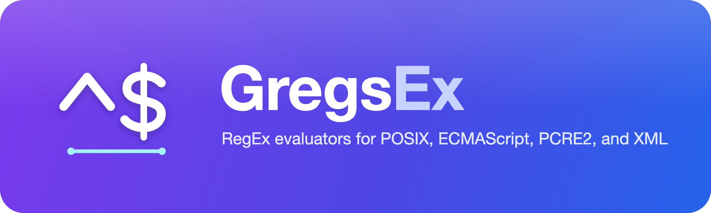

# GregsEx

**Match with boundaries. Unlike Greg.**

A fast, low allocating **regular expression library for .NET** with explicit ECMAScript,
PCRE2, XML Schema, XPath/XQuery, and POSIX support. GregsEx aims to combine
faithful, versioned regex semantics with fast span-based matching, reusable
scratch storage, and bounded execution. No external dependencies.

## Versions and package feeds

| Source | Purpose | Package feed |
| --- | --- | --- |
| `v*.*.*` | Versioned releases | [](https://www.nuget.org/packages/GregsEx) |
| `main` branch | Development previews | [](https://f.feedz.io/sebastienros/gregsex/nuget/index.json) |

For development previews, add Feedz alongside NuGet.org:

```sh
dotnet nuget add source https://f.feedz.io/sebastienros/gregsex/nuget/index.json --name gregsex-preview
dotnet add package GregsEx --prerelease
```

## Features

- **Choose the language, not just the pattern:** versioned ECMAScript 2025,
  PCRE2 10.46, XSD 1.1, XPath/XQuery F&O 3.1, and POSIX Issue 7 C-byte profiles,
  plus an experimental regular core.
- **Match without materializing strings:** Boolean searches, match ranges, and
  caller-buffer capture offsets over `ReadOnlySpan<char>` or
  `ReadOnlySpan<byte>`, where the flavor admits that representation.
- **Reuse prepared storage:** immutable, shareable patterns and disposable
  workspaces with explicit capacity reservation and opt-in growth.
- **Keep execution bounded:** finite compilation, work, and memory limits;
  cancellation and timeouts; distinct failures instead of false no-match results.
- **Use each flavor's host operations:** ECMAScript `LastIndex`, replacement
  and splitting; XML membership and F&O functions; POSIX `RegExec`; PCRE2
  partial matches, callouts, iteration, and substitution.
- **Control execution strategy:** interpretation, automatic acceleration,
  optional runtime compilation, and optional source-generated kernels.
- **Deploy with NativeAOT and trimming:** Interpreted and source generated modes based one your needs.
- **Use reproducible character rules:** select Unicode 16.0 or 17.0 in
  ECMAScript and XML profiles. Defaults remain pinned to 16.0; PCRE2 10.46
  retains its own Unicode 16.0 compatibility data, independent of host tables.

### Choose a flavor

| Profile | Semantics and notable capabilities | Subject representation |
| --- | --- | --- |
| `RegularCoreProfile` | Experimental ordered regular subset: alternatives, classes, greedy/lazy repeats, numbered captures; no lookaround or backreferences | Strict UTF-16/UTF-8 scalars, explicit UTF-16 units, or raw bytes |
| `EcmaScriptProfile` | ECMA-262 edition 16; legacy Annex B, `u`/`v`, `d/g/i/m/s/u/v/y`, named groups, backreferences, lookaround, Unicode properties and string sets | UTF-16, including lone surrogates |
| `XsdProfile` | XSD 1.1 Appendix G whole-value membership, XML name classes, Unicode categories/blocks, nested class subtraction | Strict XML UTF-16 or UTF-8 |
| `XPathProfile` | XPath/XQuery F&O 3.1 substring matching, captures, backreferences, `s/m/i/x/q`, replacement, tokenization, analysis | Strict XML UTF-16 or UTF-8; typed functions use UTF-16 strings |
| `PosixProfile` | Named Issue 7/2018 BRE/ERE C-byte profiles; leftmost-longest selection and POSIX submatch precedence | Bytes 1-255; `C`/`POSIX` locales only; no NUL |
| `Pcre2Profile` | Named PCRE2 10.46 managed standard8/16 profile; recursion, subroutines, assertions, verbs, graphemes, callouts, partial matching | Raw 8-bit, UTF-8, raw 16-bit, or UTF-16 |
| `OnigurumaProfile` | Oniguruma 6.9.10 default (Ruby) syntax, as TextMate grammars use it: possessive/atomic groups, variable-length look-behind, subexpression calls, absent repeater; a TextMate multi-pattern scanner | UTF-16 (Oniguruma's UTF-16LE decoding) |

These are separate languages, not interchangeable option sets. Unsupported
syntax or representations produce diagnostics; GregsEx never silently switches
flavors or forwards a pattern to another regex engine.

Use shared immutable presets from `RegexProfiles`, such as
`RegexProfiles.EcmaScript`, `RegexProfiles.EcmaScriptUnicodeSets`,
`RegexProfiles.Xsd`, `RegexProfiles.PosixExtended`, or `RegexProfiles.Pcre2Utf16`,
instead of repeatedly constructing common profiles.
Constructors remain available for custom flags and policies. The
[API contract](docs/specs/api.md#pattern-and-profile) lists every preset and
its fixed configuration.

Select a supported Unicode dataset explicitly when constructing a profile:

```csharp
var profile = new EcmaScriptProfile(
    EcmaScriptFlags.UnicodeSets,
    unicodeVersion: UnicodeVersion.Unicode17_0);
var letters = RegexPattern.Parse(@"\p{L}+", profile);

var xsd = new XsdProfile(UnicodeVersion.Unicode17_0);
var xpath = new XPathProfile(unicodeVersion: UnicodeVersion.Unicode17_0);
```

`UnicodeVersion` has explicit `Unicode16_0` and `Unicode17_0` members, not a
moving `Latest` value. Existing constructors and presets still use Unicode 16.
The selected dataset is immutable and appears in `profile.DataId`.
ECMAScript pairs each Unicode version with the corresponding Emoji version;
XML retains XML 1.0 Fifth Edition character/name rules for both versions.
Source-generated patterns select the same data with
`[GeneratedPattern(pattern, EcmaScriptFlags.UnicodeSets, UnicodeVersion = UnicodeVersion.Unicode17_0)]`.
XSD and XPath convenience functions also accept a `unicodeVersion` argument.

PCRE2 support is the managed standard matcher, **not** its native C ABI, native
JIT, DFA interface, 32-bit library, EBCDIC mode, or serialized native code.
POSIX support is specifically `PosixBre2018-CByte` / `PosixEre2018-CByte`, not
arbitrary locales, GNU/BSD extensions, or Issue 8. The XML APIs are regex
operations, not an XML parser, schema validator, or query evaluator.

The detailed contracts for [RegularCore](docs/specs/regular-core.md),
[ECMAScript](docs/specs/ecmascript.md), [XML](docs/specs/xml.md),
[POSIX](docs/specs/posix.md), [PCRE2](docs/specs/pcre2.md), and [Oniguruma](docs/specs/oniguruma.md)
document exact admission rules and compatibility boundaries. XML behavior
includes documented GregsEx interpretations of specification ambiguities;
these are not W3C-approved errata.

## Quick start

### Parse once, match repeatedly

```csharp
using GregsEx;

var pattern = RegexPattern.Parse("[a-z]+", RegexProfiles.EcmaScript);

Console.WriteLine(pattern.IsMatch("hello 42")); // True

using var workspace = pattern.CreateWorkspace();
ReadOnlySpan<char> input = "hello 42";
var status = workspace.Find(input, 0, out var range);

if (status == RegexSearchStatus.Match)
{
    Console.WriteLine(input.Slice(range.Index, range.Length).ToString()); // hello
}
```

Convenience `pattern.IsMatch(...)` creates temporary scratch storage and returns
a Boolean; execution failures throw `RegexExecutionException`. For repeated
operations, reuse a workspace. Its `IsMatch`, `Find`, and `FindCaptures` methods
return `RegexSearchStatus`, preserving `NoMatch`, `InvalidInput`,
`DestinationTooSmall`, `LimitExceeded`, `Cancelled`, and `TimedOut` separately.

Share a pattern across threads, but use a separate workspace or typed session
for each concurrent operation. Workspaces do not grow by default.
`CreateWorkspace` reserves capture capacity; `Reserve` can prepare more storage.
Parsing, workspace creation/growth, and owned output strings allocate separately
from warmed searches.

### Read capture offsets

```csharp
using GregsEx;

var pattern = RegexPattern.Parse(@"(?<key>[a-z]+)=(?<value>[0-9]+)", RegexProfiles.EcmaScript);
using var workspace = pattern.CreateWorkspace();
ReadOnlySpan<char> input = "count=42";
Span<RegexCapture> groups = stackalloc RegexCapture[3];
var status = workspace.FindCaptures(input, 0, groups, out var range);

if (status == RegexSearchStatus.Match && groups[2].Participated)
{
    var value = groups[2];
    Console.WriteLine(input.Slice(value.Index, value.Length).ToString()); // 42
}
```

`GroupCount` includes group zero, the whole match. Supply at least that many
capture slots. `Participated` distinguishes an absent group from a matched-empty
group; captures describe final offsets, not .NET-style capture-history collections.
Use a bounded stack buffer for small known patterns and a reusable array for
larger or dynamic capture counts.

Offsets always count the original representation: UTF-16 code units for character
input, bytes for UTF-8/raw-byte input. Pass the original subject and `startAt`;
slicing the subject first changes the context visible to anchors and lookbehind.

### Handle diagnostics and execution limits

```csharp
using GregsEx;

if (!RegexPattern.TryParse("(", RegexProfiles.EcmaScript, out _, out var diagnostic))
{
    Console.WriteLine($"{diagnostic.Code} at {diagnostic.Offset}");
}

var pattern = RegexPattern.Parse("[a-z]+", RegexProfiles.EcmaScript);
using var workspace = pattern.CreateWorkspace();
using var cancellation = new CancellationTokenSource();

var options = new RegexMatchOptions
{
    CancellationToken = cancellation.Token,
    Timeout = TimeSpan.FromMilliseconds(100),
    Limits = new RegexMatchLimits(maxWork: 100_000)
};

var status = workspace.IsMatch("hello", options: options);

if (status != RegexSearchStatus.Match && status != RegexSearchStatus.NoMatch)
{
    throw new RegexExecutionException(workspace.LastFailure);
}
```

`RegexCompileOptions` also accepts `RegexCompileLimits` and default
`RegexMatchLimits`. Per-call limits can reduce, but not increase, the pattern's
safety ceilings. A work budget is not a wall-clock guarantee. Advanced
backtracking, recursion, and backreferences remain bounded operations, not a
promise of linear execution time.

## Flavor-specific operations

### ECMAScript: stateful matching, replacement, and splitting

```csharp
using GregsEx;

var profile = new EcmaScriptProfile(EcmaScriptFlags.Global | EcmaScriptFlags.Unicode);
var pattern = RegexPattern.Parse(@"(?<word>[a-z]+)", profile);
using var matcher = EcmaScriptMatcher.Bind(pattern);
Span<RegexCapture> groups = stackalloc RegexCapture[2];

var status = matcher.ExecNext("one two", groups, out var range);

if (status == RegexSearchStatus.Match)
{
    Console.WriteLine(matcher.LastIndex); // 3
}

var replacementPattern = RegexPattern.Parse("(?<word>[a-z]+)", profile);
using var replacement = EcmaScriptMatcher.Bind(replacementPattern);
Console.WriteLine(replacement.ReplaceAll("one two", "[$<word>]")); // [one] [two]
```

The typed session supplies `Exec`, `Test`, `Match`, `MatchAll`, `Search`,
`Replace`, `ReplaceAll`, and `Split`, with private numeric `LastIndex` state.
`Exec` preserves JavaScript's empty-match behavior; `ExecNext` requires `g` or `y`
and advances after empty matches for safe caller iteration. Materialized results
and replacements have separate output limits and allocation costs.

This is a typed regex API, not a JavaScript object runtime: coercions, overridden
properties, Symbol dispatch, `RegExp.compile`, and replacement callbacks are
outside the ECMAScript host surface.

### XML Schema: whole-value validation and UTF-8

```csharp
using GregsEx;

Console.WriteLine(XsdFunctions.IsValid("bcdf", "[a-z-[aeiou]]+")); // True
Console.WriteLine(XsdFunctions.IsValid("ba", "a")); // False

var pattern = RegexPattern.Parse(
    @"\i\c*",
    RegexProfiles.Xsd,
    new RegexCompileOptions(inputKind: RegexInputKind.Utf8));

using var workspace = pattern.CreateWorkspace();
ReadOnlySpan<byte> input = "item:name"u8;
var status = workspace.Find(input, 0, out var range);

if (status == RegexSearchStatus.Match)
{
    Console.WriteLine(range.Length); // 9 bytes
}
```

XSD uses whole-value membership, not substring search. `^` and `$` are literals,
parentheses do not capture, and `GroupCount` is one. Workspace operations require
`startAt = 0`. `\i` and `\c` use XML name rules.

Both XML profiles validate the entire subject against XML 1.0 Fifth Edition
character rules and strict encoding, even after an early candidate match.
Malformed encodings, lone surrogates, and illegal XML characters are not repaired
or ignored.

### XPath/XQuery: matches, replace, tokenize, and analyze

```csharp
using GregsEx;

Console.WriteLine(XPathFunctions.Matches("Hello", "hello", "i")); // True
Console.WriteLine(XPathFunctions.Replace("item-42", "([0-9]+)", "[$1]")); // item-[42]

var tokens = XPathFunctions.Tokenize(",a,", ","); // ["", "a", ""]
var words = XPathFunctions.Tokenize("  one\ttwo  "); // ["one", "two"]
var analysis = XPathFunctions.AnalyzeString("id=42", "([0-9]+)");

foreach (var node in analysis.Nodes)
{
    if (node.Kind == XPathAnalyzeNodeKind.Group)
    {
        Console.WriteLine(analysis.Input.AsSpan(node.Range.Index, node.Range.Length).ToString()); // 42
    }
}
```

`AnalyzeString` returns an immutable typed tree of match, non-match, text, and
group nodes with parent indices and original UTF-16 ranges. No DOM is required.
The functions use F&O replacement and tokenization rules, not .NET substitution
rules. `XPathRegexException` carries the standard `FORX0001`-`FORX0004` codes;
resource and output failures remain separate.

### POSIX: leftmost-longest byte matching

```csharp
using GregsEx;

var pattern = PosixFunctions.Parse("(a|aa)(a?)"u8, RegexProfiles.PosixExtended);
using var workspace = pattern.CreateWorkspace();
Span<PosixMatch> matches = stackalloc PosixMatch[3];
var status = PosixFunctions.RegExec(workspace, "aa"u8, matches);

if (status == RegexSearchStatus.Match)
{
    Console.WriteLine($"{matches[0].Start}, {matches[0].End}"); // 0, 2
    Console.WriteLine($"{matches[1].Start}, {matches[1].End}"); // 0, 2
}
```

Unlike ordered alternatives, POSIX selects the earliest, longest whole match,
then applies its submatch priorities. In this example group 1 is `aa`, and
group 2 participates empty. `PosixDialect.Basic` selects BRE syntax and its
backreferences. Typed `Parse` selects byte input by default; generic
`RegexPattern.Parse` requires `new RegexCompileOptions(RegexInputKind.Bytes)`.
`RegExec` accepts partial output vectors; `RegError` formats native-style errors.

### PCRE2: native-width results and iteration

```csharp
using GregsEx;

var profile = RegexProfiles.Pcre2Utf16;
var pattern = Pcre2Functions.Parse("(?<word>a+)b", profile);
using var workspace = pattern.CreateWorkspace();
Span<Pcre2OffsetPair> pairs = stackalloc Pcre2OffsetPair[2];
var result = workspace.Match("zaab", 0, pairs);

if (result.Status == Pcre2MatchStatus.Match)
{
    Console.WriteLine($"{pairs[1].Start}, {pairs[1].End}"); // 1, 3
}

using var iteration = workspace.CreateIteration();
var next = iteration.Next("zaab", pairs);
```

The typed API preserves native return codes, short-vector success, partials,
marks, and independent capture endpoints, including valid reversed group-zero
ranges produced by reset-start constructs. It also provides substring/name/INFO
queries, bounded caller-buffer substitution, and match/substitution/case
callbacks. Supply the original subject on every iteration step.

Use `TryProject(Pcre2ProjectionPolicy.WholeSubjectValidated, ...)` when an eligible
typed pattern should expose the generic workspace API. Generic parsing of
`Pcre2Profile` applies that same admission: native behaviors incompatible with
whole-subject validation or ordinary match ranges require the typed API.

## Execution modes and source generation

The default is `RegexExecutionMode.Interpreted`. Opt into `Auto` to let GregsEx
choose semantic accelerators and, on an eligible untrimmed JIT runtime, compiled
UTF-16 kernels:

```csharp
using GregsEx;

var pattern = RegexPattern.Parse(
    "((a)|b)+c",
    RegexProfiles.EcmaScript,
    new RegexCompileOptions(executionMode: RegexExecutionMode.Auto));

Console.WriteLine(pattern.ExecutionBackend);
Console.WriteLine(pattern.IsMatch("ababc")); // True
```

`ExecutionBackend` reports the selected backend; accelerated interpretation
still reports `Interpreted`. Under trimming or NativeAOT, package build targets
disable automatic runtime compilation, leaving compatible accelerators and
interpretation available.

For explicit runtime compilation on a supported JIT deployment:

```csharp
using GregsEx;

var interpreted = RegexPattern.Parse("((a)|b)+c", RegexProfiles.RegularCoreUnicodeScalars);
var compiled = interpreted.Compile();

Console.WriteLine(compiled.IsMatch("ababc")); // True
```

`Compile()` returns an immutable pattern without mutating the original. It uses
an internal expression-tree compiler and carries `RequiresDynamicCode` and
`RequiresUnreferencedCode`. It throws when dynamic code is unavailable or the
pattern is ineligible, including POSIX, non-UTF-16 plans, and shapes already
served by a faster specialized path. It is not the API to use under NativeAOT.

For fixed patterns, the package includes an **optional** source generator:

```csharp
using GregsEx;
using GregsEx.SourceGeneration;

internal static partial class Patterns
{
    [GeneratedPattern("((a)|b)+c")]
    internal static partial RegexPattern Core();

    [GeneratedPattern("((a)|b)+c", EcmaScriptFlags.None)]
    internal static partial RegexPattern Ecma();
}
```

Call `Patterns.Core()` or `Patterns.Ecma()` and use the returned pattern normally.
Eligible patterns receive build-time C# kernels without runtime code generation.
The generator also accepts XPath flags, PCRE2 flags, and
`GeneratedPatternFlavor.Xsd`; unsupported shapes are diagnosed rather than
promised arbitrary generated-code coverage. Source generation is never required
to consume the library.

A source generator of your own cannot use `[GeneratedPattern]` (Roslyn
generators never see each other's output). It can instead ask the generator
assembly for the kernel source and bind it itself:

```csharp
// In the third-party generator, calling GregsEx.Generator.dll (the consumer's copy) at build time.
var result = GregsEx.SourceGeneration.KernelSource.TryEmit(
    pattern, OnigurumaOptions.CaptureGroup, "Plain", "Capture", compileOptions);
if (result.Status == KernelSourceStatus.Succeeded)
{
    // Emit result.PlainClass and result.CaptureClass (null without capture groups) into the
    // consumer, in a file starting with `using System;`, then bind:
    //   OnigurumaPattern.Parse(pattern, profile, compileOptions)
    //       .WithGeneratedKernels(result.Fingerprint, Plain.Run, Capture.Run)
}
```

`KernelSource` is a supported public surface of `GregsEx.Generator.dll`, versioned
with the library. Load the generator assembly from the consumer's own `GregsEx`
package (`$(PkgGregsEx)/analyzers/dotnet/cs/GregsEx.Generator.dll` with
`GeneratePathProperty="true"`) so the revision emitting the kernels is the one
running them; the library ignores a kernel of another revision and runs the
interpreter. `Declined` carries the planner's reason (the GREGEX003 text), `Invalid`
the parse diagnostic (the GREGEX001 content).

See the [deployment and trimming details](docs/release/platforms.md) for package
layout, feature switches, and execution-mode qualifications.

## Build

The package targets `net10.0`, `net8.0` and `netstandard2.0`; see the [platform matrix](docs/release/platforms.md)
for what each asset supports. Install the .NET 10 SDK, then:

```sh
dotnet restore
dotnet build -c Release --no-restore
dotnet test -c Release --no-build --minimum-expected-tests 1
dotnet pack -c Release --no-build
```

Sources and examples follow the root [`.editorconfig`](.editorconfig): four-space
C# indentation, braces on new lines, and `var` where the type is apparent.
Check formatting with
`dotnet format GregsEx.slnx --severity warn --verify-no-changes`.

## License and artwork

[MIT](LICENSE). Bundled Unicode data, PCRE2-derived data, and the internal
FastExpressionCompiler source have additional notices in
[`THIRD-PARTY-NOTICES.txt`](THIRD-PARTY-NOTICES.txt) and the package's `licenses/`
directory.

The [artwork](assets/README.md) includes SVG masters and PNG exports for the
package icon, square logo, and README banner. The anchored `^` / `$` mark and
purple-to-blue palette take their visual cues from
[Apex](https://github.com/sebastienros/apex/tree/main/assets).

## BenchmarkDotNet summary

These are **shared-workload measurements**, not universal speed guarantees.
BenchmarkDotNet 0.15.8, .NET 10.0.11 / SDK 10.0.400, Apple M4 Pro, macOS 15.8.1,
Arm64 RyuJIT; `ShortRunJob` and `MemoryDiagnoser`. Unless marked otherwise,
one launch, three warmups, three measured iterations, and a 200 ms target
iteration time were used.
Measured on 16 October 2026 UTC on a shared, busy host: timings are informational,
and small differences are not reliable rankings.

Execution tiers are explicit, not inferred from `Auto`:

| Tier | GregsEx | BCL (`System.Text.RegularExpressions`) |
| --- | --- | --- |
| Interpreted | `RegexExecutionMode.Interpreted` | `RegexOptions.None` |
| Runtime-compiled | Explicit `RegexPattern.Compile()` | `RegexOptions.Compiled` |
| Source-generated | `[GeneratedPattern]` | `[GeneratedRegex]` |

Setup verifies the actual GregsEx backend, matching results, capture offsets,
and stable prepared storage. Parsing, code generation, workspace creation and
warmup are outside the measured methods.

### All GregsEx flavors

Mean **nanoseconds per operation** for boolean matching of `((a)|b)+c` against
`bbaaac`, with no flags and the default Unicode version where applicable.
All profiles answer the same question on this input; their general semantics
remain different. POSIX uses six ASCII bytes; the others use six UTF-16 units.
XSD performs whole-value membership, so this table does not compare capture APIs.

| Flavor | Interpreted (ns/op) | Runtime-compiled (ns/op) | Source-generated (ns/op) |
| --- | ---: | ---: | ---: |
| RegularCore | 750.08 | 58.85 | 57.95 |
| ECMAScript | 259.97 | 64.06 | 62.18 |
| XSD | 201.22 | 37.42 | 37.52 |
| XPath | 410.36 | 38.62 | 38.69 |
| POSIX ERE | 660.90 | N/A | N/A |
| PCRE2 | 8,104.31* | 50.83 | 39.15 |

`N/A` means the execution tier is unsupported, not a fallback measurement.
Source-generated rows above use compiled generated kernels, not interpreted
fallbacks.

\* The PCRE2 interpreted cell uses the
[targeted longer-run confirmation](docs/release/performance.md#targeted-pcre2-interpreted-confirmation):
two launches, six warmups, ten measured iterations per launch, and a 1-second
target iteration time. All other cells retain the original common-run settings.
The long-match confirmation measured 245.4 microseconds versus the original
362.1 microseconds; both runs are preserved in the report.

### ECMAScript versus BCL: time and allocations

The same pattern is in the shared ECMAScript/.NET subset; BCL rows use ordinary
.NET semantics, not `RegexOptions.ECMAScript`. The short subject is `bbaaac`;
the long subject is 256 `a` characters followed by `c` (257 UTF-16 units).
Captures read group zero and both final subgroups from the short subject.
XSD is excluded from capture measurements because its groups are non-capturing.

| Workload | Tier | ECMAScript (ns/op) | ECMAScript (B/op) | BCL (ns/op) | BCL (B/op) |
| --- | --- | ---: | ---: | ---: | ---: |
| Short `IsMatch` | Interpreted | 259.97 | 0 | 210.07 | 0 |
| Short `IsMatch` | Runtime-compiled | 64.06 | 0 | 58.13 | 0 |
| Short `IsMatch` | Source-generated | 62.18 | 0 | 39.11 | 0 |
| Long `IsMatch` | Interpreted | 6,239.03 | 0 | 5,311.35 | 0 |
| Long `IsMatch` | Runtime-compiled | 298.85 | 0 | 1,858.44 | 0 |
| Long `IsMatch` | Source-generated | 264.64 | 0 | 1,723.00 | 0 |
| Short captures | Interpreted | 341.79 | 0 | 279.66 | 768 |
| Short captures | Runtime-compiled | 100.75 | 0 | 133.96 | 768 |
| Short captures | Source-generated | 92.58 | 0 | 131.09 | 768 |

Allocation values come from MemoryDiagnoser's raw byte/operation totals, not
rounded zero displays. GregsEx writes into a prepared caller-owned capture
buffer; BCL uses `Match` and group objects. The 768 B capture cost describes
these APIs and this workload, not an inherent allocation requirement of every
BCL operation.

The [full 54-case report](docs/release/performance.md#4-explicit-execution-tier-readme-comparison-readmebenchmarks)
includes long-input results for all flavors, uncertainty, raw positive allocation
totals, retained storage, and measurement warnings. These are matching-only
microbenchmarks, not universal flavor rankings or cold-start comparisons.
Maintained commands and workload definitions are in
[`benchmarks/README.md`](benchmarks/README.md).
