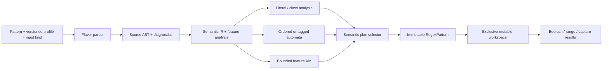

# Shared architecture and implementation boundaries

Public contracts are in [api.md](api.md), flavor rules in [flavors.md](flavors.md), and measurement requirements in [performance.md](performance.md).

## Compilation and execution

Compilation owns retained pattern text, immutable instructions, classes, name tables, profile identity and analysis. Execution borrows input only for the call. The shared IR must retain semantics that differ by flavor; there is no text-to-.NET-regex translation stage. Native libraries and System.Text.RegularExpressions may be development oracles, never hidden production fallbacks.

A compile request explicitly identifies syntax/version, flags, text representation, match-selection policy, Unicode data and resource policy. These participate in any cache key. There is no process-wide unbounded regex cache. A future application-managed cache can store immutable plans and bound both entry count and retained bytes.

## Module contracts

| Module | Responsibility and contract | Dependencies |
| --- | --- | --- |
| `Public/`, `Contracts/`, `IR/` | Stable pattern/workspace/result contracts, typed feature IDs, instructions and limits; representative usage builds | Shared data and interfaces |
| `Text/`, `Unicode/Core/` | UTF-16 units, strict UTF-8 scalar decode, raw bytes, offset/range boundary checks, compact class tables | Contracts |
| `Parsing/Core/`, `Compilation/Core/` | Explicit experimental regular subset, source ranges, bounded AST, lowering, instruction validation | Contracts |
| `Execution/Thompson/` | Correct ordered NFA reference execution; iterative state queues, epsilon closure, deduplication and captures | Contracts |
| `Runtime/` | Pattern/workspace lifecycle, plan dispatch, scratch ownership, mode/encoding validation | Validated plans and executors |
| `Flavors/<name>/` | Grammar, flags, feature admission, diagnostics, semantic lowering and adapters | Versioned contracts |
| `Execution/Backtracking/` | Iterative feature VM, rollback captures/assertions, work limits | ECMAScript and core contracts |
| `Execution/Posix/` | Tagged histories and POSIX disambiguation, BRE backreference verification | POSIX and core contracts |
| `Execution/Pcre2/` | PCRE2-specific call frames, verbs, captures and advanced feature semantics | PCRE2 and VM contracts |
| `Execution/Accelerated/` | Proven literal plans, one-pass analysis, bounded lazy DFA and safe capture recovery | All released semantics |
| `Execution/Compiled/`, `Public/Compilation/` | Bounded plan-to-expression lowering, FastExpressionCompiler adapter and annotated Compile() entry point in GregsEx.dll, using the same validated plan contract | Acceleration contract |

Interfaces sit at compile/plan boundaries, not virtual calls per character. Start with separate character and byte kernels sharing metadata; use generic/static specialization only if it removes measured duplication without boxing, accidental transcoding or code-size damage.

The core signatures are compiled in [LaneContracts.cs](../../src/GregsEx/Contracts/LaneContracts.cs), [Budgets.cs](../../src/GregsEx/Contracts/Budgets.cs) and [SemanticProgram.cs](../../src/GregsEx/IR/SemanticProgram.cs); [the core contract](regular-core.md) documents their semantics. IFlavorCompiler returns only validated immutable SemanticProgram values. ITextReader<TUnit> has static Validate/TryRead methods, allowing char/byte specialization without per-character virtual dispatch. IRegularExecutor owns a bound program, reports deterministic partition capacities and searches via generic reader specialization. Runtime binds validated plans to the corresponding executors.

RunState borrows preallocated Int32 state/capture/scratch partitions for one invocation and holds one cumulative budget/failure. SemanticProgram owns copies of validated instructions and immutable classes. Neither stores caller subject spans. Exact instruction/capture rules, source ranges, memory/work units and output precedence are frozen for core; later contracts add capabilities without exposing placeholder implementations.

## IR must preserve meaning

Retain source spans and ordered alternatives; greedy/lazy priorities; capture open/close and clear events; assertions; anchors/newline policy; class algebra; case-fold policy; code-unit versus scalar consumption; backreferences; and flavor-specific extension nodes. Assertions carry visibility bounds so lookbehind can see input before `startAt`. Scoped flags are explicit nodes or lowering context, never a global flag accidentally applied to the whole program.

`FeatureSet` records required capabilities, not syntax strings. `MatchPolicy` separates ordered leftmost-first, POSIX longest with submatch ordering, and whole-value acceptance. Do not use leftmost-first capture pruning for POSIX. Capture participation distinguishes unmatched from matched-empty; lookaround and backtracking restore capture state according to the chosen flavor. Optimizers preserve this metadata or refuse the transformation.

The AST may be richer than the lowered IR. Large bounded repeats cannot be expanded without charging compile-size/work budgets. Negated Unicode classes use interval/set algebra over the profile's legal alphabet; neither byte complements nor UTF-16 complements automatically mean scalar complements. Anchors, word boundaries and case folding use profile-specific definitions, not ambient .NET culture.

## Engines and selection

RegularCore uses a simple ordered Thompson/Pike-style reference path for the regular subset. A single search can have O(mn) work in program size m and input size n, with explicit state/capture costs; capture copying can multiply constants and storage. Do not promise linearity for unrestricted capture history, repeated suffix searches, POSIX backreferences or advanced PCRE2/ECMAScript patterns.

ECMAScript uses a bounded explicit-stack VM for lookaround/backreferences and other incompatible constructs. It can be exponential for nonregular patterns. Timeout/work-limit errors remain visible. A regular island may use an NFA/DFA only when entry/exit, captures and assertion context are preserved. Reject unsupported features during compilation.

POSIX requires POSIX selection, not a longest-match switch on the ordered engine. Compare candidate whole matches by earliest start and longest range; then apply the pinned standard's subexpression precedence. Tagged histories and dominance need ambiguity tests and bounded storage. BRE backreferences require the feature verifier and cannot inherit a blanket finite-automata time guarantee.

Accelerator selection considers operation (`IsMatch`, ranges, captures), representation, features, sizes and measured thresholds. Literal-only search, proven one-pass capture execution, bounded lazy DFA, reverse start recovery and capture re-execution are optional strategies. Cache exhaustion falls back at a well-defined search checkpoint, with the same cumulative work budget and candidate priority. Repeated fallback must not restart work indefinitely. No optimization may turn a limit failure into no-match, lose capture context, skip an earlier candidate, or skip input validation.

Both backends ship in one GregsEx package and GregsEx.dll. Runtime emission remains an internal module with an isolated compilation boundary. It consumes the same validated plan and budgets; it changes dispatch costs, not accepted syntax or meaning. Public `RegexPattern.Compile()` carries `RequiresDynamicCode`, checks runtime support for generating and compiling dynamic code, and fails clearly rather than falling back. Parse and ordinary search remain unannotated and AOT-safe. Auto invokes emission only behind runtime feature guards and may choose interpretation, with the actual backend reported.

Use FastExpressionCompiler.Internal.src, pinned and private to the library build, with internal source compiled into GregsEx.dll. Lower plans to expression trees and invoke strongly typed span delegates; do not implement a GregsEx Reflection.Emit backend. Disable FEC's fallback to Expression.Compile. Known unsupported trees can make Auto use the reference interpreter; explicit Compile fails clearly. Tree depth/node counts and code size are bounded compilation resources. FEC's own dynamic emission remains subject to the same runtime guards.

Keep FEC/expression-builder types, generated delegates and reflection metadata out of ordinary type initialization and unconditional dispatch registries. A separate compilation helper isolates loading/code generation; use a no-inline boundary when justified by startup evidence. Unreachable compiler code must be removable by trimming without a separate package. The library enables `IsAotCompatible`; scoped annotations contain the unsupported operation, while published consumer fixtures verify the safe surface. The inspected FEC source has RequiresUnreferencedCode annotations: Compile is explicitly trim-unsafe and Auto compilation is disabled for trimmed applications. A dynamic-code guard is not proof of trim safety; no blanket suppression or public annotation change substitutes for that qualification. Details and primary sources are in [the compilation specification](compilation.md).

## Safety and memory policy

`CompileLimits` and `MatchLimits` are separate immutable policies. Account for pattern units, syntax nesting, class ranges, repeat expansion, IR instructions, compilation work, Unicode/case-fold expansion, retained plan bytes, workspace bytes, VM frames, tag histories, DFA states and total transition work. Use checked arithmetic before computing capacities. Core control flow is iterative; no input-controlled call-stack growth.

Frozen core defaults: 65,536 native pattern units, nesting depth 256, 1,000,000 instructions, 65,536 class intervals, 1,024 groups including zero, 10,000,000 compile work units, 64 MiB peak live compilation memory, 64 MiB retained plan limit, 64 MiB workspace limit and 10,000,000 execution work units per search. These are safety policy values, not benchmark findings or a latency guarantee. Every input-dependent temporary AST/class/lowering allocation is admitted before allocation; replacement growth counts old and new live buffers together. Class/program copies use shared budgeted admission factories. A work unit must be defined for every kernel (including assertion/capture/retry work); timeout polling adds a separate elapsed-time limit and cancellation check. Explicitly bounded overrides are permitted; an unlimited unsafe option must not become the default accidentally.

Keep immutable arrays owned for pattern lifetime. Workspaces own mutable arrays and optionally rented buffers, with deterministic disposal and no data exposed after return. `Reserve` can allocate and must honor limits before publishing changed state. No-growth workspaces must keep reserved buffers stable and return capacity/resource exhaustion when they cannot proceed. Additional managed allocation costs must remain controlled and be reported with BDN while preserving performance. Convenience calls may acquire temporary scratch and have a separate allocation contract. Clearing policy distinguishes logical initialization from wiping sensitive contents on pool return. Never read spare capacity or overrun a span for vector padding.

## Acceptance

- **ARCH-01**: Contract samples compile and a single GregsEx library ships with IsAotCompatible enabled. Default and Auto paths publish/run without unguarded dynamic-code calls or an external regex engine; FEC source is internal, brings no shipped compiler DLL or transitive dependency, and is isolated behind the annotated compilation boundary and trimmed when unreachable. Its metadata use is qualified for the agreed trimmed JIT policy.
- **ARCH-02**: A pattern compiled once supports concurrent searches using separate workspaces with deterministic results; sharing a workspace concurrently is detected or explicitly rejected, and disposal/reuse behavior is tested.
- **ARCH-03**: Every engine admission rule has positive/negative fixtures; a forced reference plan and each admitted optimization agree on status, ranges, captures and limits on the relevant corpus.
- **ARCH-04**: Pattern/program/workspace/transition limits fail distinctly with checked capacity arithmetic; exhaustion leaves the workspace reusable and no rented storage leaked.
- **ARCH-05**: Byte offsets, UTF-16 offsets, surrogate/scalar handling and original-input assertion context survive prefilters and engine fallback.
- **ARCH-06**: POSIX tag precedence and advanced feature VM semantics cannot be selected through an incompatible ordered automata path.
- **ARCH-07**: Adding a flavor requires a profile/parser/lowering policy, capability inventory, oracle fixtures and semantic and resource test coverage; it does not require rewriting input ownership or public range types.
